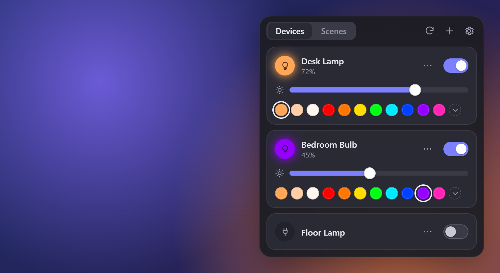
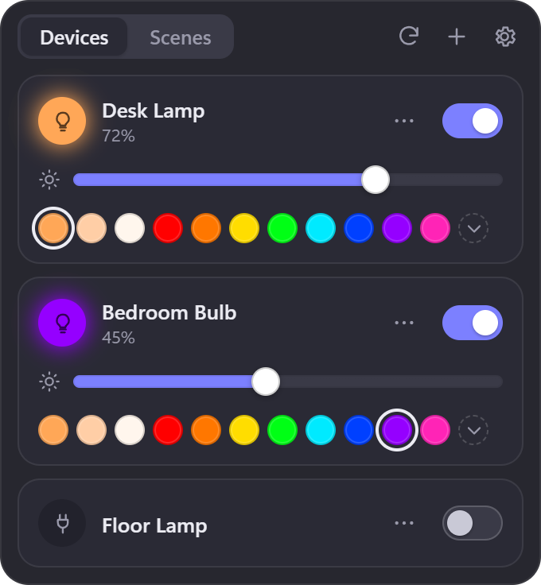
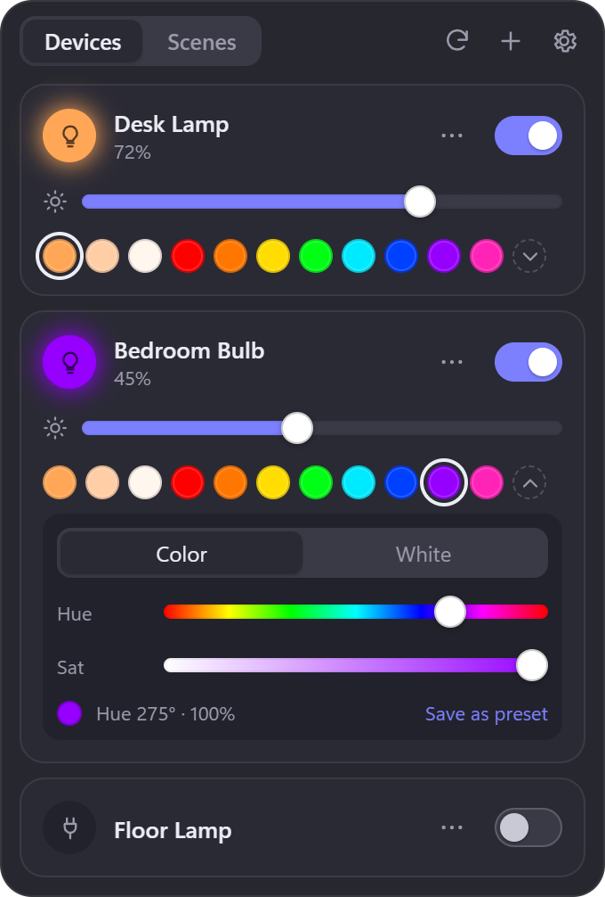
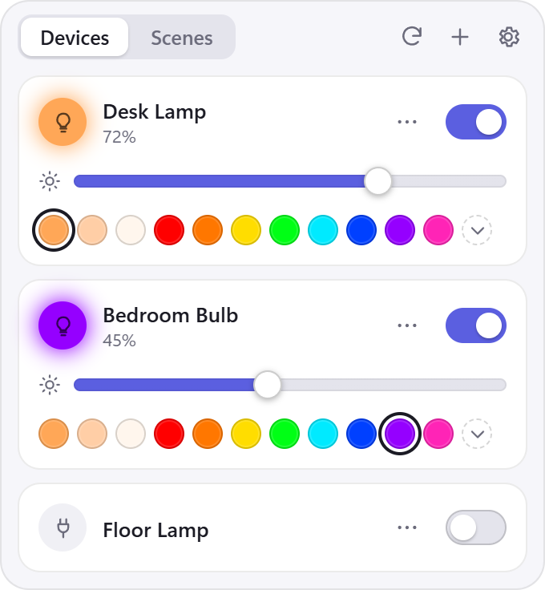
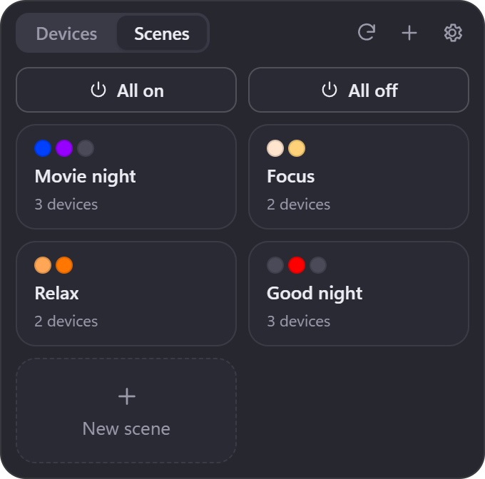
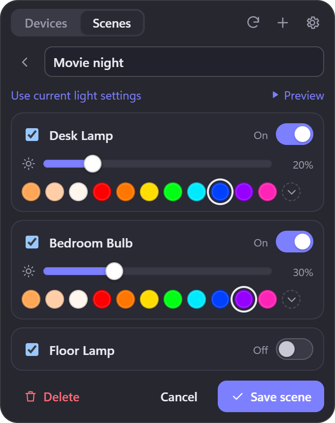
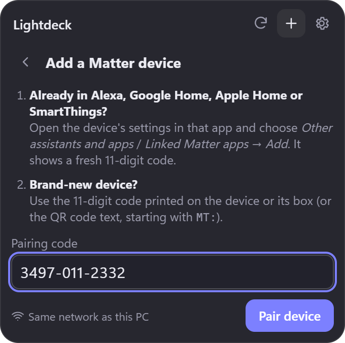
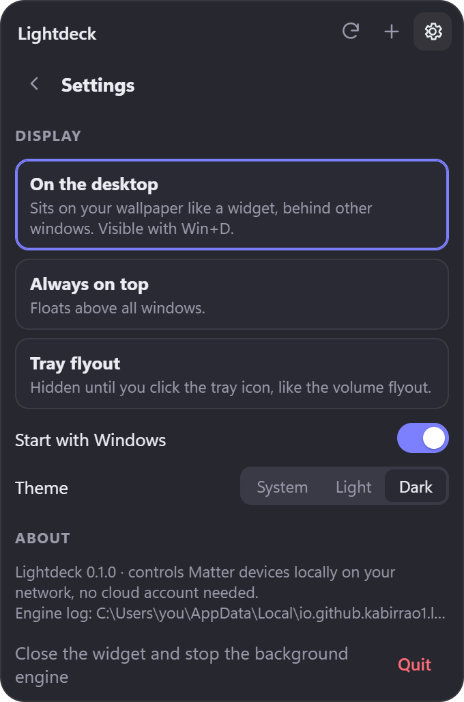

<div align="center">

# 💡 Lightdeck

**Control your Matter smart lights and plugs from a tiny widget on your Windows desktop.**

Power, brightness, colors and multi-device scenes. Local, fast, and free of cloud accounts.




</div>

---

## What is Lightdeck?

Smart lights are great until you have to pull out your phone, open an app, wait for it to load, and find the
right bulb just to dim a lamp. Lightdeck puts those controls **right on your desktop**: a small, always-ready
panel where one click turns a light on, a drag sets the brightness, and a tap picks a color.

It talks to your devices using **[Matter](https://csa-iot.org/all-solutions/matter/)**, the smart-home standard
supported by Amazon Alexa, Google Home, Apple Home and Samsung SmartThings. Everything happens **directly on your
home network**: no Lightdeck account, no cloud server, no internet round-trip. Commands reach your lights in a
fraction of a second.

And it doesn't replace anything: your lights keep working with Alexa (or whatever you use today). Matter lets a
device be controlled by several apps at once, and Lightdeck is just one more.

## Features

| | |
| --- | --- |
| 🔌 **Lights and plugs** | Any Matter light (on/off, dimmable, white-tunable or full color) and any Matter smart plug. The controls adapt to what each device can do. |
| 🎨 **Easy colors** | One-tap preset swatches (warm, neutral and cool white plus 8 colors), smooth hue / saturation / white-temperature sliders, and your own saved presets. |
| 🎬 **Scenes** | Set several devices at once: "Movie night" can dim one lamp to blue, set another to purple and switch a plug off, all in one click. |
| 🖥️ **Three display modes** | Pinned to the desktop like a widget, always on top, or a tray flyout that pops up like the volume control. |
| 🚀 **Starts with Windows** | Ready the moment you log in (you can turn this off). |
| 🪶 **Featherweight** | 0% CPU when idle: no polling and no background chatter. The app itself is a 3 MB Rust executable. |
| 🔒 **Private** | Local-only, no telemetry, no account. Your device credentials never leave your PC. |
| 🌗 **Light and dark** | Follows your Windows theme, or pick one. |

## Tested devices

| Brand | Device | Works |
| --- | --- | --- |
| **Cync** (GE Lighting) | Matter-enabled Wi-Fi color bulbs | ✅ on/off, brightness, color, white temperature |
| **Sengled** | Matter Wi-Fi color bulbs | ✅ on/off, brightness, color, white temperature |

Any Matter-certified light or plug should work, since Lightdeck only uses standard Matter features. Tried it with
something else? Please [open an issue](https://github.com/KabirRao1/lightdeck/issues) to say whether it worked,
and it'll be added here.

## Contents

- [Tested devices](#tested-devices)
- [Screenshots](#screenshots)
- [Install](#install)
- [Add your first light](#add-your-first-light)
- [Using Lightdeck](#using-lightdeck)
- [Troubleshooting and FAQ](#troubleshooting-and-faq)
- [How it works (and why Rust)](#how-it-works-and-why-rust)
- [Build from source](#build-from-source)
- [Contributing](#contributing) · [License](#license)

## Screenshots

<table>
  <tr>
    <td align="center" width="33%"><br><sub><b>Devices:</b> power, brightness and one-tap colors</sub></td>
    <td align="center" width="33%"><br><sub><b>Custom colors:</b> hue, saturation and white sliders</sub></td>
    <td align="center" width="33%"><br><sub><b>Light theme</b></sub></td>
  </tr>
  <tr>
    <td align="center"><br><sub><b>Scenes:</b> one click sets several devices</sub></td>
    <td align="center"><br><sub><b>Scene editor:</b> choose devices and their state</sub></td>
    <td align="center"><br><sub><b>Adding a device:</b> just paste a pairing code</sub></td>
  </tr>
  <tr>
    <td align="center"><br><sub><b>Settings:</b> display mode, startup, theme</sub></td>
    <td></td>
    <td></td>
  </tr>
</table>

## Install

**Requirements:** Windows 10 or 11 (64-bit), and Matter lights or plugs on the same home network as your PC.

1. Go to the [**Releases**](https://github.com/KabirRao1/lightdeck/releases) page and download
   **`Lightdeck_x.y.z_x64-setup.exe`**.
2. Run it. It installs just for your user account, so **no administrator password is needed**, and it includes
   everything Lightdeck needs. You don't have to install Rust, Node.js or anything else.
3. **"Windows protected your PC"?** Lightdeck isn't code-signed yet (certificates cost money), so Windows
   SmartScreen may warn you the first time. Click **More info → Run anyway**. If you'd rather not, you can
   [build it yourself](#build-from-source) from this source code.
4. Lightdeck starts right away and shows up in the top-right corner of your desktop. You'll also find a 💡 icon
   in the system tray (bottom-right, next to the clock; it may be hidden under the **^** arrow).

> [!IMPORTANT]
> The first time you add a device, Windows may ask whether **Node.js JavaScript Runtime** can use the network.
> That's Lightdeck's Matter engine (`lightdeck-engine.exe`, a private copy of Node.js inside the Lightdeck
> folder). Tick **Private networks** and click **Allow**. Lightdeck can't find your devices without this.

## Add your first light

Each Matter device can be paired with Lightdeck using a **pairing code**. Where that code comes from depends on
whether the device is already set up in another app.

### If your light is already in Alexa, Google Home, Apple Home or SmartThings (most common)

Your existing app can generate a fresh code that lets Lightdeck join as an extra controller. **Your light stays
in that app and keeps working with your voice assistant.**

| App | Where to find the code |
| --- | --- |
| **Amazon Alexa** | Devices → tap your light → ⚙ (Settings) → **Other assistants and apps** → **Add another** |
| **Google Home** | Tap your light → ⚙ → **Linked Matter apps & services** → **Link apps & services** |
| **Apple Home** | Long-press your light → ⚙ → **Turn On Pairing Mode** |
| **SmartThings** | Tap your light → ⋮ → **Share with other services** |

The app then shows an **11-digit code** (for example `3497-011-2332`).

> [!TIP]
> These codes expire after a few minutes, so have Lightdeck open and ready before you generate one.

### If your light is brand-new and not set up anywhere yet

Use the code printed on the device or its box. It's next to the Matter logo, either as 11 digits or as a QR
code. If you only have the QR code, scan it with your phone's camera: the text it contains (starting with
`MT:`) works too.

### Pair it

1. In Lightdeck, click **＋** (top of the widget).
2. Paste or type the code. Dashes and spaces are fine.
3. Click **Pair device** and wait a moment. It usually takes 5–20 seconds, occasionally up to a minute.
4. Give it a friendly name (like "Desk Lamp") and click **Done**.

Repeat for each light or plug. That's it!

## Using Lightdeck

### Devices tab

Each device gets its own card:

- **Toggle switch** (right): turns the device on or off.
- **Brightness slider** (☀): drag to dim. Moving it also turns the light on.
- **Glowing icon** (left): shows the light's current color at a glance.
- **Color swatches**: tap one to switch instantly. The first three are **warm, neutral and cool white**; the
  rest are colors. The ring shows which one is active.
- **⌄ (chevron)**: opens the custom color panel:
  - **Color** tab: a rainbow **Hue** slider and a **Saturation** slider (pastel → vivid).
  - **White** tab: a warm-to-cool **white temperature** slider (limited to what your bulb supports).
  - **Save as preset** adds the current color to your swatches. **Right-click** any swatch to remove it.
- **⋯ menu**:
  - **Rename** the device (just for Lightdeck; other apps keep their names).
  - **Blink to identify**: makes the light flash so you can tell which one it is.
  - **Move up / Move down** to reorder cards.
  - **Hide from widget**: tucks it away (bring it back in Settings).
  - **Remove device**: unpairs it from Lightdeck only; Alexa and friends are unaffected.

Plugs only have the toggle, since there's nothing to dim.

### Scenes tab

A scene remembers how several devices should look and applies it in one click.

- **All on / All off**: quick buttons for every visible device.
- **Tap a scene** to apply it. The colored dots preview what it does.
- **New scene**:
  1. Give it a name, like "Movie night".
  2. Tick the devices to include. For each one, choose on or off, brightness, and color.
  3. Shortcut: set your lights the way you like on the Devices tab first, then click **Use current light
     settings** to copy them into the scene.
  4. **▶ Preview** tries it out on your real lights before saving.
  5. Click **Save scene**.
- **Edit or delete**: hover over a scene and click the ✎ pencil.

### Display modes

Pick one in **Settings (⚙) → Display**:

| Mode | Behaves like | Best for |
| --- | --- | --- |
| **On the desktop** (default) | A desktop widget. It sits on your wallpaper *behind* your windows and stays visible when you press **Win + D** (show desktop). | A clean setup you can glance at. |
| **Always on top** | A floating panel above every window. | Frequent tweaking while you work. |
| **Tray flyout** | Hidden until you click the 💡 tray icon, then it pops up above the taskbar and hides when you click away. | Minimal screen clutter. |

In the first two modes, **drag the widget by its top bar** to move it anywhere; Lightdeck remembers the
position. Clicking the **tray icon** always brings the widget to the front.

### Settings

- **Display mode**: see above.
- **Start with Windows**: on by default.
- **Theme**: System, Light or Dark.
- **Hidden devices**: unhide devices you tucked away.
- **Quit**: fully closes Lightdeck, including its background engine. You can also right-click the tray icon →
  **Quit Lightdeck**.

## Troubleshooting and FAQ

<details>
<summary><b>"Couldn't find the device" when pairing</b></summary>

- Make sure the code is fresh: codes from Alexa, Google and other apps expire after a few minutes.
- Your PC must be on the **same network** as the device. Guest networks and some mesh "isolation" settings keep
  devices apart.
- Check that Windows allowed Lightdeck's engine on **private networks**: *Windows Security → Firewall & network
  protection → Allow an app through firewall* → find **Node.js JavaScript Runtime** whose path ends in
  `Lightdeck\lightdeck-engine.exe` and make sure *Private* is ticked.
- Make sure your network is set to **Private**, not Public (*Settings → Network & internet → your connection*).
- VPNs can block local discovery. Pause the VPN and try again.
</details>

<details>
<summary><b>A device shows "Offline · retry"</b></summary>

Lightdeck couldn't reach it. Check that it has power (a light switched off at the wall is unreachable) and is
connected to your network, then click **retry** or the ⟳ refresh button.
</details>

<details>
<summary><b>Does Alexa / Google / Apple Home still work after I add a light to Lightdeck?</b></summary>

Yes. Matter is designed for multiple controllers ("multi-admin"). Lightdeck joins as an additional one. Removing a
device from Lightdeck only removes Lightdeck's access.
</details>

<details>
<summary><b>Does it need the internet or an account?</b></summary>

No. Everything runs on your local network. Lightdeck has no account, no cloud service and no telemetry. (The
installer may download Microsoft's WebView2 runtime if your PC is missing it; Windows 11 already has it.)
</details>

<details>
<summary><b>What about Thread devices?</b></summary>

Matter-over-Thread devices work too, as long as your home has a **Thread border router**. Many recent Echo, Nest
Hub, HomePod and SmartThings hubs are one. Lightdeck can't do the very first Bluetooth setup of a brand-new Thread
device, so set it up in your phone's app first, then share it to Lightdeck with a pairing code as described above.
</details>

<details>
<summary><b>My light changed color from Alexa, but the widget shows the old color</b></summary>

To stay featherweight, Lightdeck doesn't keep a constant connection to your devices. It refreshes their state
whenever you open or hover over the widget, and after every change you make. Click ⟳ to refresh right away.
</details>

<details>
<summary><b>Where is my data stored? How do I reset everything?</b></summary>

| What | Where |
| --- | --- |
| Device names, scenes, presets, window position | `%APPDATA%\io.github.kabirrao1.lightdeck\config.json` |
| Matter credentials for your devices | `%APPDATA%\io.github.kabirrao1.lightdeck\matter\` |
| Engine log (helpful for bug reports) | `%LOCALAPPDATA%\io.github.kabirrao1.lightdeck\logs\matter-engine.log` |

To start fresh, quit Lightdeck and delete the `%APPDATA%\io.github.kabirrao1.lightdeck` folder. (Your devices
may still list "Lightdeck" as a linked app; remove it there if you like.)
</details>

<details>
<summary><b>How do I uninstall it?</b></summary>

*Settings → Apps → Installed apps → Lightdeck → Uninstall*. To also remove Lightdeck from your devices' linked
apps, use **Remove device** in Lightdeck first (or remove it from each device in Alexa/Google/Apple Home).
</details>

## How it works (and why Rust)

Lightdeck is made of three small pieces that work together:

```
┌──────────────────────── Lightdeck.exe (Rust · Tauri 2) ────────────────────────┐
│                                                                                │
│   Widget UI  ─────────────►  Rust core                                         │
│   (Svelte + TypeScript,      • tray icon and menu                              │
│    drawn by WebView2)        • desktop / on-top / tray window modes (Win32)    │
│                              • start with Windows, settings file               │
│                              • starts, watches and restarts the engine         │
│                                        │  JSON messages over stdin / stdout    │
│                                        ▼                                       │
│                              lightdeck-engine.exe                              │
│                              (bundled Node.js runtime running matter.js)       │
└────────────────────────────────────────┬───────────────────────────────────────┘
                                         │  Matter over your local network (UDP + mDNS)
                                         ▼
                                  💡 lights   🔌 plugs
```

### The Rust core

The heart of the app is written in **[Rust](https://www.rust-lang.org/)** using **[Tauri 2](https://tauri.app/)**.
Rust was chosen because a widget that runs all day, every day, should be tiny, fast and reliable:

- **Small:** the main executable is about **3 MB**. Instead of bundling a whole browser like Electron apps do,
  Tauri uses the WebView2 component that's already built into Windows.
- **Light on resources:** the Rust process uses about **6 MB of RAM** and **zero CPU** while idle. It doesn't
  poll or run timers; it just waits for you.
- **Safe and robust:** Rust's compiler rules out whole classes of crashes and memory bugs. The core supervises the
  Matter engine and restarts it automatically (with back-off) if it ever stops.
- **Native Windows integration:** Rust calls the Win32 API directly to pin the widget to the desktop layer
  (that's how it survives *Win + D*), keep the tray flyout clear of the taskbar, show itself without stealing
  focus, and tell WebView2 to trim its memory whenever you're not using the widget.

You only need Rust if you want to **build** Lightdeck yourself. The installer contains the compiled program.

### The Matter engine

Talking Matter is handled by **[matter.js](https://github.com/project-chip/matter.js)**, an open-source
implementation of the Matter standard. It runs in a private copy of Node.js that ships inside the installer as
`lightdeck-engine.exe`, so nothing extra needs to be installed. Lightdeck joins your devices as its own Matter
"fabric" (Matter's term for one controller's network of devices), with its own security credentials stored only
on your PC.

### The UI

The widget itself is built with **[Svelte 5](https://svelte.dev/)** and TypeScript: about 75 KB of code, drawn by
WebView2 with a transparent, rounded window. Changes appear instantly ("optimistic updates") while the command
travels to the device, and sliders are throttled so dragging sends a few commands per second instead of hundreds.

### Footprint (measured on Windows 11)

| | |
| --- | --- |
| Installer | ~24 MB |
| CPU while idle | 0% (no polling) |
| Memory while idle | ~195 MB total: Matter engine ~95 MB, WebView2 ~95 MB, Rust core ~6 MB |
| Command latency | ~20–60 ms on a local network |

## Build from source

### Prerequisites

- **[Rust](https://rustup.rs/)** (stable, with the MSVC toolchain, which is the default on Windows)
- **[Node.js](https://nodejs.org/)** 22 or newer
- **Visual Studio C++ Build Tools** ("Desktop development with C++"), which the Rust compiler needs on Windows
- WebView2 (already included in Windows 11)

### Build

```powershell
git clone https://github.com/KabirRao1/lightdeck
cd lightdeck
npm run setup        # install dependencies and bundle the Matter engine
npm run app:dev      # run in development mode (hot-reloading UI)
npm run app:build    # build the installer → src-tauri/target/release/bundle/nsis/
```

The first Rust build takes a few minutes; later builds are much faster.

### Test without real hardware

The repo includes a **virtual Matter light** (and plug) that runs on your PC, so you can develop without owning
any devices:

```powershell
npm run virtual-light                       # a color bulb; prints its pairing code
npm run virtual-light -- plug 5542 3841     # an on/off plug on another port
```

Pair it from Lightdeck like a real device. When running several virtual devices, use their QR text (`MT:...`),
because their 11-digit codes are identical.

### Regenerate the README screenshots

The screenshots above are taken from the real UI with sample data (no real devices or desktop involved):

```powershell
npm run dev            # terminal 1: serve the UI
npm run screenshots    # terminal 2: uses your installed Microsoft Edge
```

### Project layout

| Path | What's inside |
| --- | --- |
| `src/` | The widget UI (Svelte 5 + TypeScript) |
| `src-tauri/` | The Rust core: window modes, tray, autostart, config, engine supervision |
| `sidecar/` | The Matter engine (matter.js controller) and dev tools (`dev/virtual-light.ts`, `dev/drive.mjs`) |
| `scripts/` | Screenshot tooling (`screenshots.mjs` plus a mock backend) |
| `docs/screenshots/` | Images used in this README |

### Engine protocol

The Rust core and the engine exchange one JSON object per line:

```jsonc
// request                                      // response
{"id":1,"method":"set","params":{"id":"1/1","level":40}}   →   {"id":1,"ok":true,"result":{...device...}}
```

| Method | Params | Does |
| --- | --- | --- |
| `list` | – | Devices from the local cache |
| `refresh` | `nodeIds?` | Re-read live state from devices |
| `commission` | `code` | Pair a new device (11/21-digit code or `MT:` QR text) |
| `set` | `id, on?, level?, hue?, sat?, kelvin?, transition?` | Control one device |
| `setMany` | `actions[]` | Apply a scene; reports success per device |
| `identify` | `id` | Blink a device |
| `remove` | `nodeId` | Unpair a device |

Events: `ready`, `status` (pairing progress), `stopped`, `fatal`.

## Contributing

Bug reports, device compatibility reports and pull requests are all welcome! If a device misbehaves, please
include its brand and model plus the engine log (see the FAQ for its location).

Ideas on the roadmap:

- Optional live state sync (Matter subscriptions) for people who don't mind a little idle traffic
- Rooms / groups
- A global hotkey to show the widget
- macOS and Linux builds (Tauri and matter.js both support them)

## License

[MIT](LICENSE) © 2026 KabirRao1. The installer bundles Node.js (MIT) and matter.js (Apache-2.0); their licenses
are included as `THIRD-PARTY-LICENSES.txt` in the install folder.

<sub>Matter is a trademark of the Connectivity Standards Alliance. Lightdeck is an independent project and is not
affiliated with, endorsed by, or certified by the CSA.</sub>
